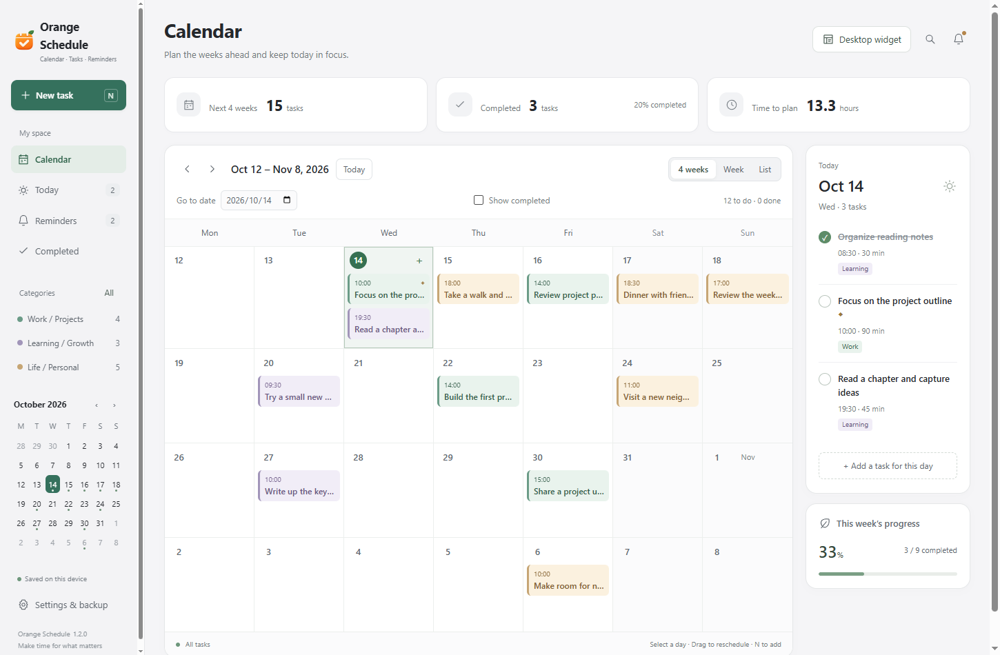
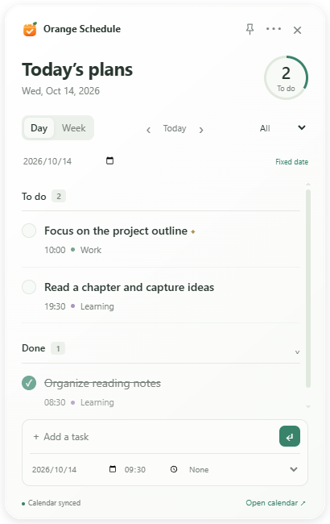
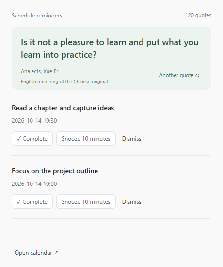

[简体中文](README.md) | **English**


# Orange Schedule: Open-Source Windows Calendar Planner, To-Do List and Desktop Sticky Notes

Orange Schedule (橙子日程) is a **free, open-source Windows calendar planner and to-do list app**, with an EXE installer for **Windows 10 / 11 x64**. Organize work and study with a desktop calendar, daily or weekly desktop sticky notes, four-week planning and a weekly timetable. Scheduled reminders help you follow up on each task.

Built with Electron, the app includes everything needed in its Windows installer; users do not need to install Node.js or a browser separately. Plans and settings stay in the current Windows user's data directory. Everyday planning works offline without an account. The source code is licensed under MIT.

The app supports **English and Simplified Chinese**. Choose a language during installation, or change it anytime under **Settings & backup → App language**. The calendar, desktop notes, reminders and tray menus follow the selected language.



## Download and Install

**[Download the Windows installer (1.2.1, x64)](https://github.com/OrangeCatzhang/orange-schedule/releases/download/v1.2.1/OrangeSchedule-Setup-1.2.1.exe)** · [All releases and checksums](https://github.com/OrangeCatzhang/orange-schedule/releases)

The source code is hosted on GitHub. Windows installers are distributed publicly through GitHub Releases and are not stored in the source repository.

Run the downloaded installer, choose **English** or **简体中文**, then choose an installation location when prompted. End users do not need Node.js or build tools. The installer can create desktop and Start menu shortcuts, and the installed app can be configured to start with Windows.

The current version is **1.2.1**. The installer does not yet use a commercial code-signing certificate, so Windows may show an unknown publisher warning. Check the download source and the SHA-256 checksum provided on the release page.

## Features

- **English and Chinese interfaces:** choose a language during installation or switch in Settings without restarting. Your task titles and notes stay exactly as written.
- **Four-week calendar and weekly planning:** view the coming weeks and switch between a four-week calendar, a weekly timetable and a task list.
- **To-do and completed lists:** organize tasks by their scheduled date, mark them complete or incomplete, and filter by status.
- **Daily and weekly desktop sticky notes:** view today's or this week's tasks in a separate desktop window, add tasks quickly and keep changes synchronized with the main calendar.
- **Bottom placement by default, with an always-on-top option:** the sticky note returns below ordinary windows when opened, unpinned or unfocused. Use the pin button to keep it on top; text input and task checkboxes remain available.
- **Categories, search and rescheduling:** organize tasks into work, study and life categories, search titles and notes with Ctrl+K, and drag calendar tasks to change their date or time slot.
- **Daily, weekday and weekly recurring tasks:** repeat daily or on weekdays (Monday–Friday) through a chosen end date, or repeat weekly for 4, 8 or 12 weeks. Edit each occurrence separately, or mark the selected occurrence and subsequent ones complete, restore them to the to-do list or delete them together.
- **Scheduled reminders:** get reminders at the scheduled time or in advance through system notifications and a separate reminder window, with a 10-minute snooze and catch-up reminders after resuming.
- **120 classical quotations and verses:** sourced Chinese quotations about learning, reflection, perseverance and the beauty of life. They appear in a random, non-repeating cycle that continues after restarting, and the reminder window lets you switch to another quotation.
- **In-app update notices:** check GitHub for the latest stable release after startup and every six hours while running. Settings include manual checks, release notes and an installer download link. Automatic checks can be disabled.
- **System tray and startup with Windows:** reminders continue in the background after the main window closes. The installed app can be set to start with Windows.
- **Sticky note appearance and position:** choose from three color themes, control whether completed tasks are shown, move or resize the window, and retain its position, size and view settings.
- **Local storage and JSON backups:** plan offline, export backups and merge imported data. Saving uses temporary-file replacement and retains the previous saved copy.

## Use Cases

- **Study plans and exam preparation:** schedule revision, reading, assignments and classes, and reserve study time in a weekly planner.
- **Work schedules and task management:** organize meetings, project milestones and daily work, and keep track of tasks after rescheduling them.
- **Desktop to-do lists and sticky notes:** keep today's or this week's tasks visible, check them off directly and pin the window on top when needed.
- **Personal time management:** plan the coming weeks in a desktop calendar and set reminders for exercise, classes and everyday activities.

## Getting Started with the Calendar and Desktop To-Do List

Click **New task** or press **N**. Click a date to view its plans, double-click an empty date area to create a plan, or click an existing plan to edit it. Use **Ctrl+K** to search titles and notes.

In **Today**, tasks with notes show a single line of smaller gray text beneath their details, so short notes can be read without opening the editor. Longer notes end with an ellipsis; hover over the preview to see the note text. Line breaks are collapsed only in the preview, leaving the saved notes unchanged. Tasks without notes do not gain an extra row.

In the **List** view, click **+ Add task** beside a date heading to add another task for that day. The date is filled in automatically, and the button remains available after saving. Multiple independent plans can share the same date and time.

When creating a plan, set **Repeat** to **Every day**, then choose **Repeat until (inclusive)**. The default range covers 30 days starting from the start date; you can change the end date. For example, October 9 through November 8 creates 31 occurrences with the same start time and reminder settings. Editing an occurrence affects only that day. When completing, restoring or deleting a task, choose **This task only** or **This and following tasks**. The series ends on the selected date; create another series if you want to continue it.

For a weekday schedule, choose **Weekdays (Monday–Friday)** and set the end date. Saturdays and Sundays within the range are skipped. For example, October 16, 2026 (Friday) through October 20 (Tuesday) creates three occurrences: October 16, 19 and 20. The app shows the actual count before saving and asks you to adjust the dates if the range contains only a weekend. Weekdays mean Monday–Friday; public holidays and substituted working days are not detected automatically. Existing plans remain unchanged, including any weekend tasks created earlier.

Open sticky notes with **Desktop widget** at the top right of the main window or from the tray menu. The day/week buttons change the date range; arrows move between dates, and the date field lets you jump to a date. **Today** restores tracking of the current date. Drag the header to move the window or its edges to resize it. Use **⋯** to change the color and visibility of completed tasks.

Closing the main window keeps the tray and reminders running. To stop the app completely, choose **Quit Orange Schedule** from the tray menu or use the quit button in Settings. Closing a sticky note only hides that window.



### Batch Actions for Recurring Tasks

New daily, weekday and weekly series store group information. When later occurrences exist, clicking a completion button or deleting a task in the editor opens a scope selector. It defaults to **This task only**. Choose **This and following tasks** to review the count and full list before confirming. The main calendar, desktop sticky notes and reminder window share this workflow. Completed tasks can be restored to the to-do list using the same scope choices.

For grouped series, “subsequent” follows the original recurrence order. Rescheduling or renaming an individual occurrence does not change its group or original position in the series; the preview shows its actual date. Batch completion does not toggle already completed tasks back to incomplete. Batch deletion also removes the corresponding reminder records.

Older versions did not store recurrence groups. For those tasks, the app proposes candidates only when **the creation timestamp, title, start time, duration, category, reminder, priority and notes all match**, then lists subsequent candidates by their current scheduled date and time. It explicitly asks you to review the list before choosing a batch action; matching titles alone do not merge tasks. Older tasks without a creation timestamp, or with an individually changed title or other matching field, may need to be handled separately.

If another window changes a task while you are confirming a batch action, the operation stops and asks you to review the list again. Single-task deletion also checks the selected task, but changes to later occurrences do not block deletion of that one task.

### In-App Update Notices

Enable **Settings & backup → Automatically check for updates** to check once after startup and every six hours while the app remains open. A notice appears above the calendar when a new stable release is available. You can also click **Check for updates** manually or **Later** to temporarily hide the notice.

The app displays release notes. **Download installer** opens the Windows EXE for the corresponding repository release in your browser. After downloading, quit the old version from the tray and install to the same location. This feature provides update notices and a download link; it does not install updates silently.

Since 1.1.11, update checks first read a public version file in the repository and make one fallback attempt through the GitHub Releases API only if that fails. This reduces reliance on the shared anonymous API quota. The public file is still subject to network and access restrictions. If both sources fail, Settings shows the reason and keeps **Open official downloads** available. Plans and reminders continue to work, and failed checks do not modify local plans.

**Versions 1.1.8 and earlier do not have update checks and require a manual installation of the current version. If 1.1.9 or 1.1.10 reports a GitHub rate limit, download from this page and manually upgrade to 1.2.1 once to use the public version file.**

### Classical Quotations in Reminders

System notifications and reminder windows display the same quotation and its source. All selections come from classical Chinese sayings and poetry, including passages on learning and reflection from the *Analects*, perseverance from *Xunzi*, and perspective and calm from Tang and Song poetry. Chinese mode uses Simplified Chinese characters and modern punctuation. English mode displays this project’s English renderings of the Chinese originals, with translated source labels; links to the original texts are retained in the quotation catalog. These are not quotations from a published modern translation.

There are 120 quotations. None repeats before the current cycle is complete, and the first quotation of a new cycle differs from the previous one. The cycle position is stored locally and continues after restarting or switching languages. **Another quote** changes only the displayed text; it does not send another notification or alter the task.

In **Settings & backup**, enable **Reminder window** and click **Send a test reminder** to preview it. See the [reminder quotation library](docs/reminder-copy.md) for the full collection and source references (in Chinese).



### Operating Limitations

Reminders cannot appear while the computer is shut down or hibernating, or while the app is not running. After the app starts again or the computer resumes, it sends catch-up reminders for incomplete tasks for which a reminder has not already been sent. Windows notification permissions and Focus Assist may affect system notifications. The separate reminder window can be enabled or disabled in Settings.

Sticky notes are separate windows and are not embedded in the Explorer desktop. **Win+D / Show desktop may hide them too**; reopen them from the main window or tray. To-do and completed tasks are grouped by scheduled date. Recurring tasks support individual editing and scoped completion or deletion.

## Frequently Asked Questions

### How do I switch between English and Chinese?

The same installer includes both languages. On first installation, the app uses the selected installer language. Upgrading a Chinese-only profile without a saved language preference also uses the installer's selection. Once you save a language preference, subsequent upgrades preserve it. Change it anytime under **Settings & backup → App language**; no restart is required.

Switching language preserves your plans, notes, backups and quotation rotation. To keep existing installations and Windows startup entries compatible, the executable and shortcut names remain **橙子日程**, and the data directory remains `weeklight`.

### What is included in the free, open-source version?

This repository contains the complete application source under the MIT license, and Releases provides free Windows installers. The calendar, to-do lists, desktop sticky notes and reminders are all included.

### Do desktop sticky notes stay in sync with the calendar?

Sticky notes show the same plan data for the selected day or week. Completing, reopening or adding a task updates the main calendar as well, so you can manage today's or this week's tasks directly from the desktop window.

### Do I need an account to plan offline?

No account is required. Plans, reminder status and settings stay on your computer. Everyday scheduling and task management work offline; export and import JSON backups to move data between computers.

### Why does the “Start with Windows” checkbox clear itself?

Upgrade to 1.1.4 or later. Version 1.1.3 could display an outdated checkbox state when a state notification was delayed. Later versions use the latest state returned by the save operation and verify that Windows accepted the change. If Windows does not save it, Settings shows a specific error so you can check permissions or security software as appropriate.

### Why does checking for updates report a GitHub rate limit?

GitHub supports anonymous access, but its REST API normally shares a quota of 60 requests per hour per public IP address. Other applications using the same network connection may consume that quota, so a single check can encounter a limit. See [GitHub's official rate-limit documentation](https://docs.github.com/en/rest/using-the-rest-api/rate-limits-for-the-rest-api).

Upgrade to 1.1.11 or later. Newer versions read the public version file first and do not use the Releases API during a successful normal check. No login or token is required. If online checking is unavailable, open the official download page from Settings. Public files remain subject to network and service access restrictions; they are not an unlimited service.

### Why does the taskbar still show Electron or an old icon?

Version 1.1.12 uses consistent window and taskbar icons and separates development and production taskbar identities. After upgrading, quit the old version from the tray and restart the app. If you manually pinned an old shortcut, unpin it and pin the app again from the Start menu.

### Is the downloaded EXE an installer or a standalone program?

`OrangeSchedule-Setup-1.2.1.exe` is an installer. After installation, launch Orange Schedule from the desktop or Start menu; no separate Node.js installation is needed. It is not a single-file portable app. If you build from source and use the unpacked version, keep the entire `win-unpacked` folder together.

## Data and Privacy

The app was renamed from 周光 Weeklight to 橙子日程 (Orange Schedule) in 1.1.3. Public releases retain the original `weeklight` data directory, installation identity and JSON backup format. Upgrading from 1.1.2 in the same installation location preserves access to existing plans. The GitHub repository is now `orange-schedule`, and the old repository URL redirects automatically. Historical releases and backups under the old name remain available.

By default, the app uses Electron's application data directory for the current user, usually `%APPDATA%\weeklight` on Windows. View or open the actual path from **Settings & backup**. Plans are stored in `plans.json`; the previous saved copy is `plans.json.bak`. App upgrades normally retain this directory. Export a backup before uninstalling or moving to another computer.

Use the `WEEKLIGHT_DATA_DIR` environment variable to select another directory. The app does not automatically search for or migrate data from other paths. Users of early test versions can export JSON from the old version and import it into the current one.

The app has no account service, cloud sync or telemetry. Automatic and manual update checks request only the repository's public version file or GitHub's public release information; they do not upload plans, notes or backups. Automatic checks can be disabled in Settings. Source code and public installers do not include personal plans, backups, browser caches or local verification reports.

## Run from Source

Requirements: **Windows x64, Node.js 22.12 or later, and npm**. The project has been verified with Node.js 24. The native window-layer helper is built with the system's .NET Framework C# compiler, using the .NET Framework 4.x environment on Windows 10 / 11.

```powershell
git clone https://github.com/OrangeCatzhang/orange-schedule.git
cd orange-schedule
npm ci
npm start
```

`npm start` builds the native helper first. End users can use the installer instead.

### Verify and Build

```powershell
npm test
npm run test:widget
npm run test:layer
powershell -NoProfile -ExecutionPolicy Bypass -File scripts/build.ps1
npm run test:packaged
npm run test:startup
npm run test:reminder
npm run test:list
npm run test:daily
npm run test:weekdays
npm run test:series
npm run test:updates
npm run test:branding
npm run test:language
```

Desktop tests require an interactive Windows desktop and use isolated test data. Build artifacts are written to `outputs/weeklight-1.2.1/`: `OrangeSchedule-Setup-1.2.1.exe` is the installer, and `win-unpacked/橙子日程.exe` can run directly if the entire `win-unpacked` folder is retained.

`npm run test:ui` provides additional main-calendar regression checks. The optional `scripts/prepare-runtime.cjs` prepares Electron for offline use and requires Python and an official Electron ZIP with a matching checksum. It is not needed for a normal `npm ci` installation.

## Project Structure

- `src/main.cjs`: desktop windows, tray, data and reminders.
- `src/reminder-copy.cjs`, `src/reminder-*.json`: 120 reminder quotations and their persistent rotation.
- `src/core.cjs`, `src/task-series.cjs`, `src/data-path.cjs`: plan validation, recurrence groups, batch actions and data directory handling.
- `src/task-actions.*`: shared action-scope selection for the three window types.
- `src/update-*`, `src/updates.*`: stable-release checks, update notices and download links.
- `src/renderer.js`, `src/style.css`: main calendar interface.
- `src/i18n.js`, `src/locale-*.js`, `src/installation-language.cjs`: translations, live language switching and initial language selection.
- `scripts/installer.nsh`: installer language selection and first-launch preference.
- `src/widget-*`: desktop sticky note model, window and interface.
- `src/native/WindowLayer.cs`: Windows native helper that only adjusts application window layering.
- `docs/updates/latest.json`: update manifest for the verified public release.
- `scripts/write-update-manifest.cjs`: version-manifest generation. The [release procedure](docs/releasing.md) requires verification of the public installer before updating the manifest (in Chinese).
- `tests/`: data-boundary, interaction, native window-layer and package verification.

## License and Feedback

The project source is available under the [MIT license](LICENSE). Electron, Chromium and other dependencies have their own licenses; binary releases retain the accompanying third-party license files.

Report problems through [Issues](https://github.com/OrangeCatzhang/orange-schedule/issues). Remove personal plan details before sharing screenshots or logs.

The interface organization draws inspiration from [TickTick](https://www.ticktick.com/windows), [Notion Calendar](https://www.notion.com/product/calendar) and [Apple's Human Interface Guidelines](https://developer.apple.com/design/human-interface-guidelines/). The code and interface are independently implemented, and this project is not affiliated with those products.
