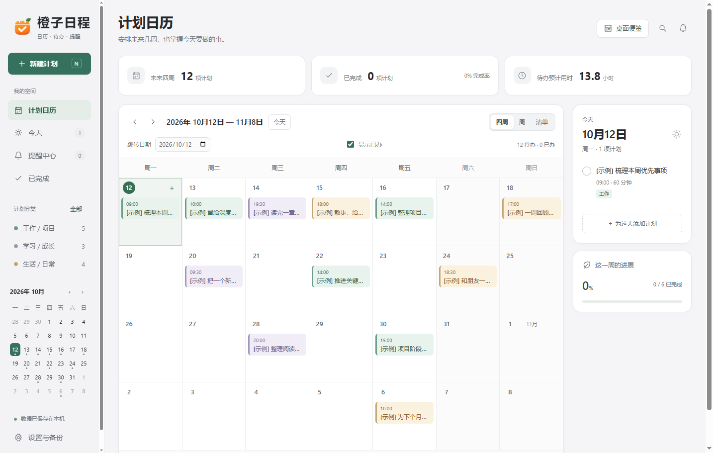

**简体中文** | [English](README.en.md)


# 橙子日程：Windows 开源日程管理、桌面日历与待办清单

橙子日程是一个 **免费开源的 Windows（Win）日程管理项目**，提供适用于 **Windows 10 / 11 x64** 的 EXE 安装包。通过桌面日历、待办清单和日 / 周桌面便签安排学习与工作，用四周规划和周时间表管理未来几周，再通过定时提醒跟进每一项计划。

应用使用 Electron 构建，提供可直接安装的 Windows EXE 安装包，无需单独安装 Node.js 或浏览器。计划与设置保存在当前 Windows 用户的数据目录中，支持离线使用，无需注册账号。源码采用 MIT 许可证。

应用界面和内置名言诗词目前为简体中文；项目介绍提供中文和 [English](README.en.md) 两个版本。



## 下载与安装

**[下载 Windows 安装包（1.1.12，x64）](https://github.com/OrangeCatzhang/orange-schedule/releases/download/v1.1.12/OrangeSchedule-Setup-1.1.12.exe)** · [全部版本与校验文件](https://github.com/OrangeCatzhang/orange-schedule/releases)

源码托管在 GitHub，安装 EXE 通过 GitHub Releases 公开分发，不进入源码仓库。

下载安装包后直接运行，按提示选择安装位置。终端用户无需安装 Node.js 或编译工具。安装版可创建桌面与开始菜单快捷方式，并可在设置中启用开机启动。

当前版本 **1.1.12**。安装包尚未使用商业代码签名证书；Windows 可能显示未知发布者。请核对下载来源和发布页提供的 SHA-256。

## 功能

- **四周日历与周计划**：查看未来几周的安排，切换四周日历、周时间表和任务清单。
- **待办事项（To-do List）与已办清单**：按计划日期整理任务，勾选完成或撤销完成，支持只看待办或已办。
- **日 / 周桌面便签**：在独立桌面小窗口查看当天或本周清单，快速新增任务，与主日历同步。
- **默认沉底与置顶**：便签打开、取消置顶或失去焦点后回到普通窗口下方；图钉可切换置顶，仍可正常输入和勾选。
- **分类、搜索与改期**：按工作、学习、生活分类，用 Ctrl+K 搜索名称和备注，拖动日历任务调整日期或时段。
- **每天 / 工作日 / 每周重复计划**：每天或每个工作日（周一至周五）重复至指定结束日期，或每周连续 4、8、12 周；每次事项可单独编辑，也可将此项及后续事项批量完成、恢复为待办或删除。
- **定时提醒与日程提醒**：到点或提前提醒，系统通知与独立提醒弹窗，支持稍后 10 分钟提醒及恢复后补发。
- **120 条名言警句与诗词提醒**：全部选用有出处的古典名句和诗词，涵盖学习、自省、坚持与生活之美；每轮随机展示且不重复，重启后继续轮换，弹窗可手动换一句。
- **应用内升级提示**：启动后与运行期间每 6 小时检查 GitHub 最新稳定版，设置页支持手动检查、查看更新说明和下载安装包，可关闭自动检查。
- **系统托盘与开机启动**：关闭主窗口后继续在后台提醒；安装版可在设置中选择开机启动。
- **便签外观与位置恢复**：三种配色，控制已办清单显示，拖动和缩放窗口，保存位置、大小及视图设置。
- **本地保存与 JSON 备份**：支持离线规划、备份导出与合并导入；保存采用临时文件替换，并保留上一份数据副本。

## 使用场景

- **学习计划与备考安排**：安排复习、阅读、作业和课程，用每周计划表分配学习时段。
- **工作日程与任务管理**：整理会议、项目节点和日常工作清单，改期后继续跟进待办事项。
- **电脑桌面待办与便签**：随时查看今天或本周要做的事，直接勾选，必要时置顶。
- **个人时间管理与生活计划**：在桌面日历中安排未来几周，为运动、课程和日常事务设置提醒。

## Windows 日程管理与桌面待办：开始使用

点击「新建计划」或按 **N**。单击日期查看当天计划，双击空白日期创建；点击已有计划编辑。**Ctrl+K** 搜索名称与备注。

在「清单」视图中，点击每个日期标题右侧的「＋ 添加计划」可继续添加当天事项，日期会自动填写。保存后入口仍保留；同一天、同一时刻也可以创建多项独立计划。

新建时将「重复」设为「每天重复」，再选择「重复结束日期（含当天）」。默认生成从开始日期算起的 30 天计划，可调整结束日期。例如 10 月 9 日至 11 月 8 日会生成 31 项，每天使用同一开始时间和提醒设置。修改仍只影响当前一天。完成、恢复为待办或删除时，可选择「仅此项」或「此项及后续」；保存后不会无限延续，到期后可再新建一段。

工作日安排可选择「工作日重复（周一至周五）」，再设置结束日期，范围内的周六、周日不创建事项。例如 2026 年 10 月 16 日（周五）至 10 月 20 日（周二），只创建 16、19、20 日三项。保存前会显示实际数量；如果范围只有周末，会提示调整日期。工作日按周一至周五计算，不自动识别法定节假日或调休。已有计划保持原样，不会自动清除以前创建的周末事项。

从主窗口右上角「桌面便签」或托盘菜单打开便签。日 / 周按钮切换范围；箭头翻页，日期框跳转，「今天」恢复跟随当前日期。拖动顶部移动，拖动边缘调整大小；「⋯」调整颜色和已办显示。

关闭主窗口后，托盘和提醒继续运行。需要彻底停止时，在托盘选择「退出橙子日程」，或使用设置中的退出按钮。关闭便签只隐藏便签。


### 重复事项批量处理

新建的每天、工作日及每周重复事项会保存分组信息。点击完成按钮，或在编辑窗口选择删除，存在后续事项时会显示范围选择；默认「仅此项」，选择「此项及后续」后可核对数量和完整清单。主日历、桌面便签和提醒窗口共用这一流程，已完成事项也可按相同范围恢复为待办。

新分组的「后续」按创建时的重复顺序计算。单独改期或改名不会改变所属分组和原始顺序；预览会列出实际日期。批量完成不会把已完成事项反转为待办，批量删除会一并移除对应提醒记录。

旧版没有保存重复分组信息，因此只将**创建时间相同且标题、时间、时长、分类、提醒、优先级和备注都匹配**的事项列为候选，按当前日期时间列出后续清单。应用会明确提示先核对，再由用户选择批量操作；不会只按标题相同自动合并。缺少创建时间、已单独改名或改变上述属性的旧事项可能无法匹配，仍需单独处理。

确认期间若事项被其他窗口改动，批量操作会停止并提示重新确认，避免误处理变化后的清单。单项删除也会核对所选事项，其他后续事项的变化不会阻止单项删除。

### 应用内升级提示

启用「设置与备份 → 自动检查更新」后，应用在启动后检查一次，持续运行时每 6 小时检查一次。发现新稳定版会在日历顶部提示；也可点击「检查更新」手动检查，或选择「稍后」暂时隐藏提示。

应用会显示更新说明。点击「下载安装包」将在浏览器打开该仓库对应版本的 Windows EXE；下载后从托盘退出旧版，再安装到原位置。此功能负责提示和下载入口，不会静默安装。

从 1.1.11 起，检查优先读取仓库的公开版本文件，读取失败时才尝试一次 GitHub Releases API，减少对匿名 API 共享配额的依赖。公开文件仍可能受网络或访问限制影响；如果两个来源都失败，设置页会显示原因，并始终保留「打开官方下载页」入口。计划与提醒继续工作，检查失败不会改动本地计划。

**1.1.8 及更早版本没有升级检查功能，需要手动安装当前版本。1.1.9 / 1.1.10 若提示 GitHub 检查次数受限，也请从本页下载并手动升级至 1.1.12 一次，新版才会使用公开版本文件。**

### 名言警句与诗词提醒

提醒到来时，系统通知和提醒弹窗使用同一句名句，并显示作品出处。内容全部选自古典名言警句与诗词，例如《论语》的学习与自省、《荀子》的坚持，以及唐宋诗词中的开阔与从容；采用简体字和现代标点，原文来源可在文案库中核对。

共 120 条文案，一轮看完前不重复，下一轮的第一句也不会与上一句相同。轮换进度保存在本机，重新启动后继续。弹窗中的「换一句」只切换文案，不会额外发送通知或更改任务。

可在「设置与备份」开启「独立提醒窗口」，再点击「发送测试提醒」预览。完整文案和古典名句出处见[提醒文案库](docs/reminder-copy.md)。


### 运行边界

关机、休眠或应用退出期间不能即时提醒；再次运行或恢复后会补发仍未完成、尚未提醒的事项。Windows 通知权限和专注助手可能影响系统通知，独立提醒弹窗可在设置中控制。

便签是独立窗口，没有嵌入资源管理器桌面。**Win+D / 显示桌面可能把便签一起隐藏**，可从主窗口或托盘重新打开。待办与已办按计划日期分组，重复事项支持单项编辑和按范围完成、删除。

## 常见问题

### 免费开源版包含什么

当前仓库提供 MIT 许可的完整应用源码，Releases 提供免费 Windows 安装包。日历、待办清单、桌面便签与提醒功能均包含在此版本中。

### 桌面便签与日历中的待办是否同步

便签按所选日期或周显示同一份计划数据，勾选完成、撤销完成和新增任务会同步到主日历。适合需要把今天或本周任务放到电脑桌面上查看的用户。

### 离线日程管理是否需要注册

无需注册，计划、提醒状态和设置都保存在本机。日常安排与任务管理可以离线使用；跨电脑迁移可导出和导入 JSON 备份。

### 开机自动启动勾选后又取消

请升级到 1.1.4 或更高版本。1.1.3 在状态通知延迟时可能显示旧的勾选状态；新版使用保存返回的最新状态，并核验 Windows 是否接受修改。若系统没有保存，会在设置页显示具体错误，可按提示检查权限或安全软件拦截情况。

### 检查更新提示 GitHub 次数已达限制

GitHub 提供匿名访问，但其 REST API 通常按公网 IP 共享每小时 60 次配额。同一个网络出口的其他程序也可能消耗配额，因此只点一次检查也可能遇到限流，详情见 [GitHub 官方说明](https://docs.github.com/en/rest/using-the-rest-api/rate-limits-for-the-rest-api)。

请升级至 1.1.11 或更高版本。新版优先读取公开版本文件，正常检查不调用 Releases API，无需登录或提供密钥；无法联网检查时，可以在设置中打开官方下载页。公开文件也受网络和服务访问限制影响，并非无限制服务。

### 任务栏仍显示 Electron 或旧图标

1.1.12 已统一窗口和任务栏图标，并分离开发版与正式版的任务栏标识。升级后请从托盘退出旧版再启动；如果手动固定过旧版快捷方式，可取消固定后从开始菜单重新固定。

### 下载的 EXE 是安装包还是单文件程序

下载的 `OrangeSchedule-Setup-1.1.12.exe` 是安装程序。安装后通过桌面或开始菜单启动橙子日程，无需额外安装 Node.js。它不是可独立拷走运行的单文件应用；从源码构建的免安装目录需完整保留 `win-unpacked` 文件夹。

## 数据与隐私

从 1.1.3 起，应用由「周光 Weeklight」更名为「橙子日程」。公开版沿用原来的 `weeklight` 数据目录、安装标识和 JSON 备份格式；从 1.1.2 在原安装位置升级可继续使用已有计划。GitHub 仓库现为 `orange-schedule`，旧仓库地址自动跳转；历史版本与旧名称的备份继续保留。

默认使用 Electron 的当前用户应用数据目录；在 Windows 上通常位于 `%APPDATA%\weeklight`。实际路径可在「设置与备份」中查看或打开。数据文件为 `plans.json`，上一份保存副本为 `plans.json.bak`。升级应用通常保留此目录；卸载或迁移前建议导出备份。

可通过 `WEEKLIGHT_DATA_DIR` 环境变量指定其他目录。应用不会主动查找或迁移其他路径中的数据。早期测试版本用户可先从旧版导出 JSON，再在新版中导入。

应用没有账户服务、云同步或遥测。自动或手动检查更新只请求仓库的公开版本文件或 GitHub 的公开发行信息，不上传计划、备注或备份；自动检查可在设置中关闭。源码和公开安装包不包含个人计划、备份、浏览器缓存或本机验证报告。

## 从源码运行

需要 **Windows x64、Node.js 22.12 或更高版本、npm**；本项目使用 Node.js 24 验证。原生层级助手由系统的 .NET Framework C# 编译器构建（Windows 10 / 11 的 .NET Framework 4.x 环境）。

```powershell
git clone https://github.com/OrangeCatzhang/orange-schedule.git
cd orange-schedule
npm ci
npm start
```

`npm start` 会先编译原生助手。普通用户使用安装包即可。

### 验证与构建

```powershell
npm test
npm run test:widget
npm run test:layer
powershell -NoProfile -ExecutionPolicy Bypass -File scripts/build.ps1
npm run test:packaged
npm run test:startup
npm run test:reminder
npm run test:list
npm run test:daily
npm run test:weekdays
npm run test:series
npm run test:updates
npm run test:branding
```

桌面测试需要可交互的 Windows 桌面，并使用独立测试数据。构建结果在 `outputs/weeklight-1.1.12/`：`OrangeSchedule-Setup-1.1.12.exe` 为安装包，`win-unpacked/橙子日程.exe` 可直接运行（需保留整个 `win-unpacked` 文件夹）。

`npm run test:ui` 提供额外的主日历回归验证。可选的 `scripts/prepare-runtime.cjs` 用于离线准备 Electron，需要 Python 和匹配校验值的官方 Electron ZIP；正常 `npm ci` 不需要运行它。

## 项目结构

- `src/main.cjs`：桌面窗口、托盘、数据与提醒。
- `src/reminder-copy.cjs`、`src/reminder-*.json`：120 条提醒文案及持久化轮换。
- `src/core.cjs`、`src/task-series.cjs`、`src/data-path.cjs`：计划校验、重复分组、批量操作和数据目录。
- `src/task-actions.*`：三种窗口共用的操作范围选择。
- `src/update-*`、`src/updates.*`：稳定版检查、升级提示和下载入口。
- `src/renderer.js`、`src/style.css`：主日历界面。
- `src/widget-*`：桌面便签模型、窗口与界面。
- `src/native/WindowLayer.cs`：仅调整应用窗口层级的 Windows 原生助手。
- `docs/updates/latest.json`：已验证公开发行版的更新清单。
- `scripts/write-update-manifest.cjs`：生成版本清单；[发布步骤](docs/releasing.md)要求先核验公开安装包再更新清单。
- `tests/`：数据边界、交互、原生层级与打包验证。

## 开源与反馈

本项目代码按 [MIT 许可证](LICENSE) 开源。Electron、Chromium 及其他依赖遵循各自许可证；二进制发行保留随附的第三方许可文件。

欢迎通过 [Issues](https://github.com/OrangeCatzhang/orange-schedule/issues) 反馈问题。提交截图或日志前请移除个人计划内容。

界面组织参考 [TickTick](https://www.ticktick.com/windows)、[Notion Calendar](https://www.notion.com/product/calendar) 和 [Apple 界面指南](https://developer.apple.com/design/human-interface-guidelines/)，代码与页面为独立实现，与这些产品没有隶属关系。
